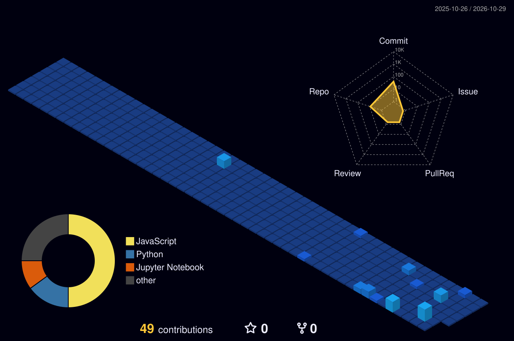

<div align="center">


<br>


</div>

---

## 👨‍💻 About Me

```python
class Developer:
    def __init__(self):
        self.name = "Shivam Verma"
        self.role = "Data Science Enthusiast"
        self.languages = ["Python", "SQL", "R"]
        self.interests = [
            "Machine Learning",
            "Data Analytics",
            "Artificial Intelligence",
            "Web Development"
        ]

    def current_goal(self):
        return "Learn. Build. Improve. Repeat."

me = Developer()
```

- 🔭 Building projects in AI and Data Science
- 🌱 Exploring Machine Learning and real-world applications
- 📊 Passionate about extracting meaningful insights from data
- 💡 Interested in solving real-world problems through technology
- ⚡ Always curious about learning something new

---

## 🛠️ My Tech Arsenal

<div align="center">

### Languages


<br>


### Data Science & Machine Learning


<br>


### Visualization & Tools


<br>


</div>

---

## 🚀 Featured Projects

<div align="center">

<a href="https://github.com/csshivamverma54/GestureBridge">

</a>

</div>

### 🤟 GestureBridge

AI-powered bidirectional sign language translation platform designed to bridge communication between Deaf/Hard-of-Hearing and hearing individuals.

**Tech:** Python • React • PyTorch • MediaPipe

[🌐 Live Demo](https://gesturebridge1.onrender.com) | [📂 Source Code](https://github.com/csshivamverma54/GestureBridge)

### 📊 Netflix Data Analysis

Exploratory Data Analysis of Netflix content, uncovering trends in genres, release years, countries, and content distribution.

**Tech:** Python • Pandas • NumPy • Matplotlib • Seaborn

### 🎓 Student Performance Prediction

A Machine Learning project predicting student performance using Linear Regression and academic factors.

**Tech:** Python • Pandas • Scikit-learn

---

## 📈 GitHub Analytics

<div align="center">


<br><br>


</div>

---

## 📊 Contribution Activity Graph

<div align="center">


</div>

---

## 🌌 My 3D Contribution Universe

<div align="center">



<br>

<i>Every contribution is a step towards becoming better.</i>

</div>

---

## 🏆 GitHub Achievements

<div align="center">


</div>

---

## 🌐 Let's Connect

<div align="center">

<a href="https://github.com/csshivamverma54">

</a>

</div>

---

<div align="center">

### 💭 Developer Mindset

*"First, solve the problem. Then, write the code."*

<br>

⭐ Thanks for visiting my profile!


</div>
